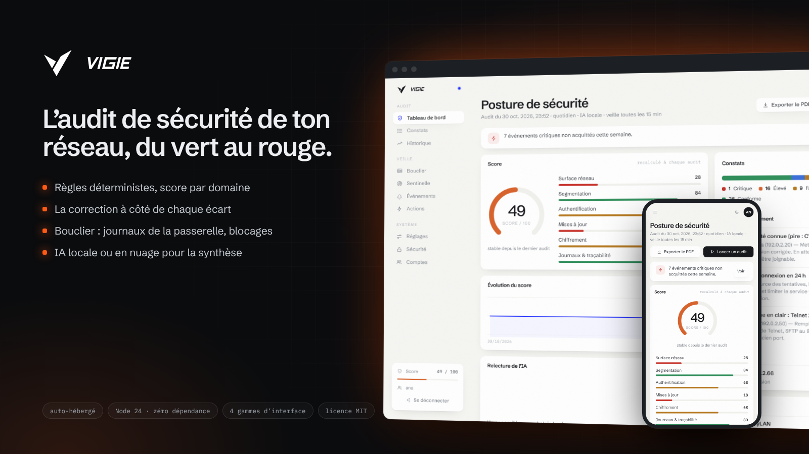
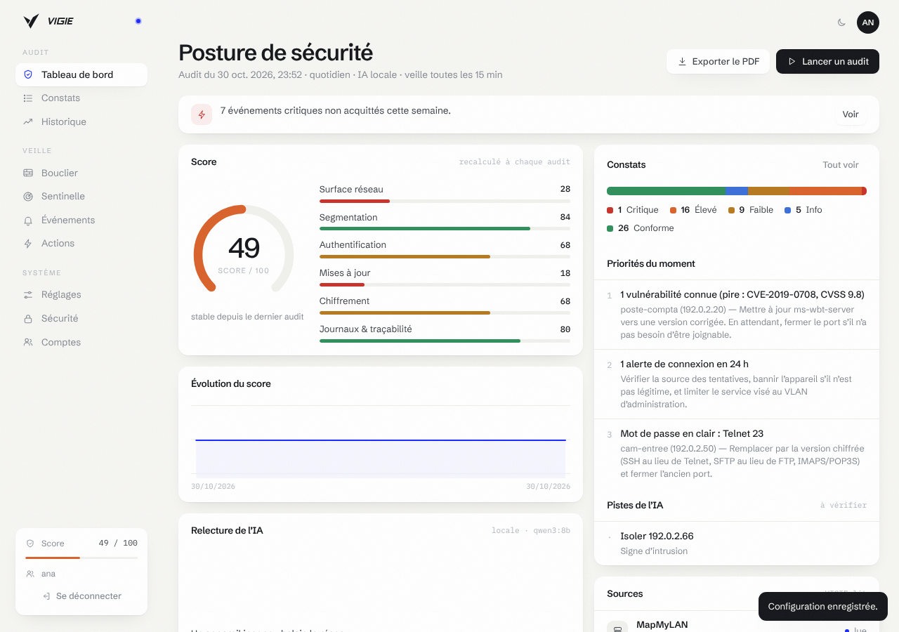
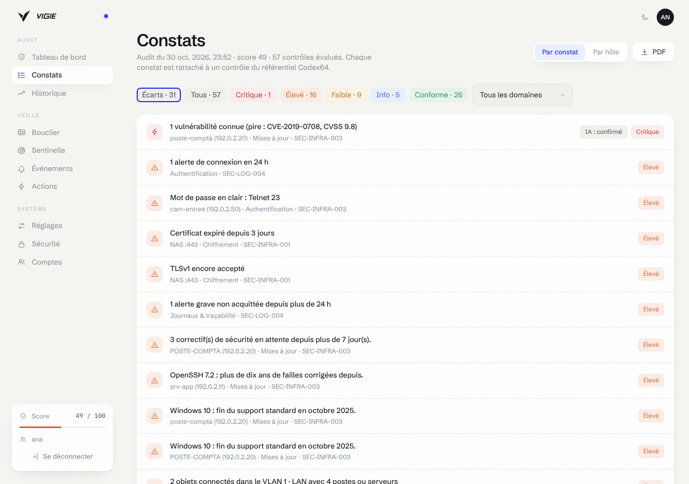
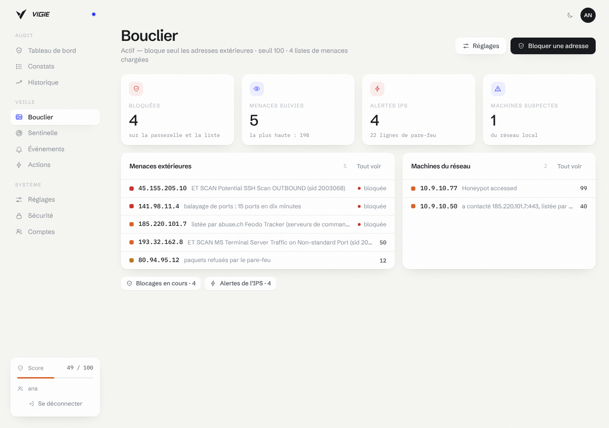
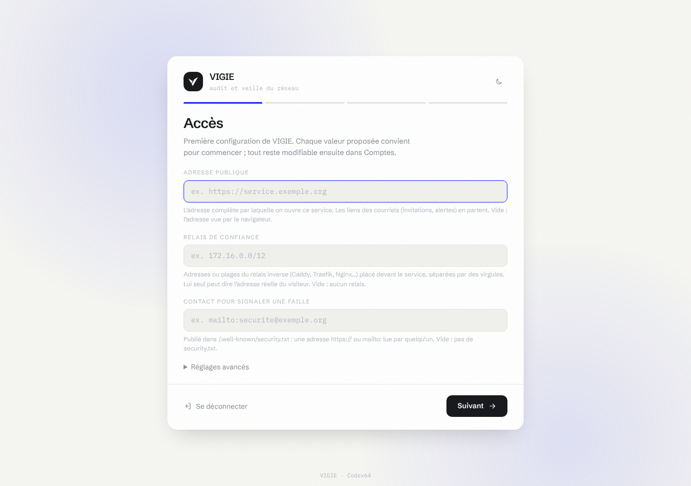

<p align="center">
  <picture>
    <source media="(prefers-color-scheme: dark)" srcset="medias/logo-sombre.svg">
    
  </picture>
</p>

<p align="center"></p>

# VIGIE

Audit et veille de sécurité du réseau, sous le Hub. VIGIE lit ce que les
autres services savent déjà (MapMyLAN, NEXARC, docker-control), le confronte
à des règles fixes rattachées au référentiel Codex64, et donne un score par
domaine, du vert au rouge, avec la correction à côté de chaque écart. Une IA
— locale, en nuage, les deux, ou aucune — peut relire l'audit : elle confirme
ou écarte les constats et rédige la synthèse ; elle ne change ni les gravités
ni le score.

- **Moteur sans IA.** Règles déterministes : mêmes entrées, même résultat. Six
  domaines (surface réseau, segmentation, authentification, mises à jour,
  chiffrement, journaux), cinq gravités (conforme, info, faible, élevé,
  critique). Le conforme se compte aussi.
- **IA au choix.** Locale (l'Ollama du Hub : rien ne sort du réseau), en
  nuage (Anthropic, OpenAI ou Kimi avec ta clé), les deux (la locale relit,
  le nuage tranche), ou secours (la locale, le nuage si elle échoue). Plafond
  quotidien d'appels et de jetons, compté localement ; `max_tokens` borne
  chaque appel chez le fournisseur.
- **Veille continue.** Toutes les quinze minutes par défaut : nouveaux
  appareils, nouveaux ports, signes d'intrusion, trafic suspect, VLAN qui ne
  sont plus isolés, sources muettes. Un audit complet par jour.
- **Deux régimes de remédiation.** Par défaut VIGIE propose : rien ne
  s'exécute sans une personne. La réaction rapide (isoler seul un appareil
  sur un signe d'intrusion caractérisé) est coupée tant qu'un administrateur
  ne l'a pas allumée, sous renfort ; elle ne vise que les types d'appareils
  choisis, jamais l'infrastructure, et s'arrête au plafond horaire. Toute
  action passe par MapMyLAN, dans les plages qu'il déclare : instantané,
  vérification, retour arrière si elle n'a pas pris, annulation possible.
- **Bouclier.** VIGIE lit les journaux de la passerelle UniFi (alertes de
  l'IPS — le Suricata intégré à la passerelle UniFi —, pot de miel, refus du pare-feu),
  les croise avec des listes de menaces publiques (abuse.ch, Spamhaus,
  Emerging Threats, CINS, blocklist.de) et note chaque adresse. Au seuil,
  une adresse extérieure est bloquée seule à la frontière, par l'API
  officielle d'UniFi ; une machine du réseau qui se comporte comme une
  machine compromise est signalée (et isolée seulement par la réaction
  rapide). Détail plus bas.
- **Sentinelle.** Les journaux des hôtes du réseau (SSH, sudo, comptes, cron,
  systemd, noyau, NAS Synology, Proxmox, serveurs web, Docker, Home Assistant,
  Nextcloud, Vaultwarden, courrier, Wi-Fi, DHCP, DNS…) arrivent par le même
  syslog ; un moteur de décodeurs et de règles en arbre — l'architecture
  d'OSSEC, réécrite — donne à chaque ligne un niveau de 0 à 15 : force brute,
  compte forcé, compte créé ou ajouté aux administrateurs, tâche planifiée
  d'implant, écoute du réseau, outil de balayage web, service de sécurité
  arrêté. Les alertes nourrissent le bouclier, lèvent des événements, et
  défilent en direct dans l'interface. Détail plus bas.
- **Rapport PDF** horodaté en un clic, écrit côté serveur sans dépendance.
- **Diffusion.** Déclencheurs pour les workflows du Hub, billetterie au
  format ticket/v1 (Aselia), Telegram, et SYNAPSE pour la mémoire des audits.
- **Page Vigie dans MapMyLAN** (2.1 et plus) : score, priorités, événements,
  et les constats de chaque appareil dans sa fiche.

## Aperçu

|  |
|:--:|
| Le tableau : score par domaine |

|  |
|:--:|
| Les constats et leur correction |

|  |
|:--:|
| Le bouclier de la passerelle |

Quatre gammes d’interface au choix — SOMA, Console, Exploitation, Lavande — en clair ou en sombre, de 360 à 1920 px de large.

## Installation

Depuis le Hub : Catalogue → VIGIE. MapMyLAN est requis ; NEXARC,
docker-control, Ollama et SYNAPSE sont pris s'ils sont installés. Le Hub
donne à VIGIE, pour chaque source, un jeton dérivé qui ne vaut que pour elle
(voir [docs/INTEGRATION.md](docs/INTEGRATION.md)). Le jeton de docker-control
se pose dans VIGIE → Réglages.

### Installation seule

La clé maîtresse vit dans un secret Docker, hors du volume de données, lisible
par l'utilisateur du conteneur (10004) seul. Garder une copie hors ligne de
`secrets/socle_cle` : sans elle, une sauvegarde de la base ne rouvre ni les
secrets TOTP ni ceux des réglages.

```bash
# .env : VIGIE_HUB_TOKEN (openssl rand -hex 24), MAPMYLAN_URL, MAPMYLAN_JETON (docs/INTEGRATION.md)
mkdir -p secrets && openssl rand -base64 32 > secrets/socle_cle && : > secrets/socle_cle_ancienne
sudo chown 10004:10004 secrets/socle_cle secrets/socle_cle_ancienne && sudo chmod 400 secrets/socle_cle secrets/socle_cle_ancienne
docker compose up -d --build
docker compose logs vigie | grep "Jeton d'installation"
```

Sans `SOCLE_CLE` ni `SOCLE_CLE_FILE`, la clé est créée dans `DATA_DIR/cles`,
ce qui ne convient qu'au développement.

**Tourner la clé maîtresse.** La clé actuelle dans `SOCLE_CLE_ANCIENNE` (le
Hub, ou `secrets/socle_cle_ancienne`), une neuve (`openssl rand -base64 32`)
dans `SOCLE_CLE`, puis redémarrer : VIGIE rescelle chaque secret TOTP et chaque
secret de ses réglages, et l'écrit dans ses journaux. Vider ensuite
l'ancienne et redémarrer. Une clé que la base ne connaît pas arrête le
démarrage au lieu de perdre les secrets.

### Sauvegardes

Une sauvegarde est un instantané cohérent de la base, chiffré pour une clé
publique RSA (3072 bits au moins) dont la clé privée ne vit **pas** sur la
machine de VIGIE.

```bash
# Une fois, sur le poste qui gardera la clé privée :
openssl genpkey -algorithm RSA -pkeyopt rsa_keygen_bits:3072 -out vigie-sauvegarde.pem
openssl pkey -in vigie-sauvegarde.pem -pubout -out vigie-sauvegarde.pub
# Chaque jour, sur l'hôte de VIGIE (la clé publique suffit) :
docker exec -i <vigie> node src/cli.js sauvegarde < vigie-sauvegarde.pub > vigie-$(date -u +%F).sauv
# Restauration, sur le poste de la clé privée, dans un fichier neuf :
node src/cli.js restaurer vigie-sauvegarde.pem vigie.db < vigie-AAAA-MM-JJ.sauv
```

**Incident.** `docker exec <vigie> node src/cli.js secrets retirer` oublie la
clé d'IA, les jetons Telegram, docker-control, UniFi, Cloudflare et de la liste
des pare-feu, et la clé de la billetterie (ou ceux d'un seul canal) ; les
révoquer aussi chez leur fournisseur. Voir SECURITY.md, « Incident runbook ».

## Première configuration et mises à jour

Au premier démarrage, ouvre l’interface : tu crées le compte administrateur avec
le jeton d’installation (affiché dans les journaux du conteneur, ou transmis par
le Hub), tu inscris tes facteurs de connexion, puis l’**assistant de
configuration** passe les réglages de VIGIE groupe par groupe. Il est
obligatoire : VIGIE reste fermé tant qu’il n’est pas terminé. Chaque valeur
proposée convient pour commencer.

<p align="center"></p>

Réglages demandés : adresse de MapMyLAN, jeton de MapMyLAN pour VIGIE, adresse de NEXARC, jeton de NEXARC pour VIGIE, port syslog publié sur la machine, iA des audits, adresse d’Ollama, modèle local, fournisseur en nuage, modèle en nuage, clé d’API du fournisseur, appels par jour au plus ; plus ceux de
tous les services (adresse publique, relais de confiance, gamme de
l’interface, contact de sécurité, courriels d’alerte).

Après une mise à jour qui apporte un réglage nouveau, l’assistant revient au
passage suivant d’un administrateur et ne demande **que ce réglage-là**. Une
mise à jour sans réglage nouveau ne demande rien : une fenêtre « Quoi de neuf »
résume ce qu’elle apporte, une fois par compte, et se ferme d’un clic
(`nouveautes.json`).

Tout reste modifiable dans **Comptes → Réglages du service**. Une variable
posée dans l’environnement l’emporte toujours et n’est pas demandée. VIGIE
redémarre seul pour appliquer un changement (le processus du conteneur le
supervise). Les valeurs vivent dans `reglages.json`, dans le volume de
données ; les secrets y sont scellés par la clé maîtresse.

## Bouclier

VIGIE ne réécrit pas un moteur d'inspection de paquets : il pilote ceux qui
existent. Sur un réseau UniFi, c'est la passerelle UniFi qui inspecte (IPS Suricata,
pot de miel, pare-feu) ; VIGIE lit ce qu'elle voit, décide, et lui rend des
listes d'adresses à refuser. Rien n'est à installer ailleurs.

**Relié tout seul par MapMyLAN.** Quand MapMyLAN pilote déjà le routeur
principal (relié dans son « Équipement réseau », par le Hub), VIGIE s'en sert
sans rien régler : elle y lit chaque minute les alertes de l'IPS et y tient
les groupes d'adresses à refuser, avec le jeton que le Hub a dérivé pour elle
(MapMyLAN 2.2 ou plus). Les identifiants du routeur restent dans MapMyLAN.
Une clé d'API UniFi posée dans VIGIE passe avant.

**Ce qu'il lit.** Un récepteur syslog (UDP et TCP, port 5514 par défaut,
`SYSLOG_PORT` dans le Hub) : CEF d'UniFi Network (Activity Logging → SIEM
Server), lignes du pare-feu (CyberSecure → Traffic Logging), et EVE JSON de
Suricata si une sonde existe ailleurs. Seuls les émetteurs déclarés sont lus
— un journal se falsifie, et VIGIE agit sur ce qu'il lit. Tant qu'aucun
émetteur n'est déclaré, toute adresse privée est lue, mais ce qu'elle écrit ne
fait rien bloquer ni isoler seul : VIGIE le signale (« menace signalée »),
puisque n'importe quelle machine du réseau a pu l'écrire. Déclarer la
passerelle (Bouclier → Réglages → Émetteurs) rend la riposte automatique ; les
sondes, qui ont leur jeton, et la relève par MapMyLAN font toujours foi.

**Comment il note** (idées de Suricata, sshguard, psad et CrowdSec, pas leur
code). Chaque observation ajoute des points à l'adresse qui la porte, avec sa
raison : alerte de l'IPS de gravité 1 = 100, 2 = 40, 3 = 10 ; balayage de
ports ou d'adresses, force brute sur un port d'authentification = 60 dans une
fenêtre de dix minutes ; présence sur une liste de menaces = son poids. Le
score s'efface de moitié chaque heure. Les listes ne bloquent rien seules :
elles pèsent sur une adresse vue en train d'agir. Une machine du réseau
monte quand elle touche le pot de miel, contacte un serveur de commande
connu, déclenche une signature de compromission, balaie le réseau interne ou
demande des noms générés par algorithme.

**Ce qu'il fait.** Trois modes : observer, simulation (note ce qu'il aurait
bloqué), actif (par défaut). En actif, une adresse extérieure au seuil est
bloquée 1 h, puis 1 jour, 7 jours, 30 jours à chaque récidive ; plafond de
blocages automatiques par heure. Jamais une adresse privée ou réservée, un
résolveur DNS public, Cloudflare (le tunnel du Hub), ni la liste blanche.
Chaque blocage se lève en un clic. Les blocages vont :

- sur la passerelle : par MapMyLAN (groupes « VIGIE bloquees IPv4 » et
  « … IPv6 »), ou directement par l'API d'intégration d'UniFi Network 9 ou
  plus (listes « VIGIE · bloquées IPv4 » et « … IPv6 » ; la clé d'API ne part
  qu'à une passerelle dont le certificat a l'empreinte confirmée par
  l'administrateur). Deux règles du pare-feu, posées une fois dans UniFi,
  refusent ces groupes en entrée et en sortie ; VIGIE vérifie qu'elles
  existent ;
- dans une liste texte (`/api/bouclier/liste.txt`, jeton dédié) pour un autre
  pare-feu qui lit une URL (pfSense, OPNsense, MikroTik).

**La tempête.** Un déni de service distribué n'est pas une adresse de plus :
c'est des dizaines d'adresses sur le même port en une minute. VIGIE compte
les sources distinctes par port et le débit de lignes entrantes ; au-delà des
seuils (40 sources et 600 lignes par minute, réglables), il lève un événement
critique « Tempête sur le port X », bloque d'emblée les adresses les plus
bruyantes (hors plafond horaire : c'est précisément le moment), et, si tu l'y
as autorisé, passe tes zones Cloudflare en mode « Under Attack » pour un
temps. Il dit aussi ce qu'il ne peut pas : un flot qui sature la fibre
s'arrête en amont (Cloudflare, fournisseur d'accès), jamais sur la passerelle.

**Cloudflare, en amont.** Avec un jeton d'API (Compte → Listes de filtres :
Modifier ; Zone → Zone : Lire ; Zone → Pare-feu WAF : Modifier ; Zone →
Paramètres de zone : Modifier), VIGIE tient dans ton compte une liste
`vigie_bloquees` — les mêmes adresses que sur la passerelle, IPv6 en /64 —
et pose sur chaque zone choisie une règle du pare-feu applicatif qui la
refuse : un attaquant bloqué chez toi l'est aussi avant le tunnel. Le mode
« Under Attack » se pose et se lève à la main, ou seul en tempête, et
l'ancien niveau de sécurité revient à l'échéance.

Mise en route : relier le routeur dans MapMyLAN suffit pour les alertes de
l'IPS et les blocages ; restent les deux règles du pare-feu (VIGIE → Bouclier
→ carte « Passerelle »), et, pour le pot de miel et les refus du pare-feu,
les journaux de la passerelle (carte « Journaux de la passerelle »).

## Sentinelle

Le bouclier regarde la frontière ; la sentinelle regarde dedans. Chaque hôte
qui envoie ses journaux au port syslog de VIGIE (rsyslog `*.* @@vigie:5514`,
Synology « Envoi des journaux », Proxmox, Docker en `log-driver: syslog`,
OpenWrt…) est lu ligne à ligne. L'architecture est celle des analyseurs
d'événements classiques (OSSEC, Wazuh), réécrite de zéro et sans leur code :

1. **Pré-décodage** : l'heure, l'hôte, le programme, le numéro de processus,
   séparés du message (RFC 3164, RFC 5424, journald, ligne nue).
2. **Décodeurs** : trente familles (sshd, dropbear, PAM, sudo, su, comptes,
   login, systemd, cron, noyau, Synology DSM, Proxmox VE, nginx/Apache/Caddy,
   Docker, Home Assistant, Nextcloud, Vaultwarden, Jellyfin, Grafana, Gitea,
   Portainer, Postfix/Dovecot, FTP, Samba, fail2ban/CrowdSec, hostapd, DHCP,
   dnsmasq/Pi-hole/unbound, OpenVPN/WireGuard) qui reconnaissent le *geste*
   (mot de passe refusé, session ouverte, commande élevée, compte créé,
   service arrêté, requête web…) et en tirent les champs : adresse source,
   utilisateur, port, URL, statut, commande, groupe, interface.
3. **Règles en arbre** (une centaine) : une racine par geste, des précisions
   (compte d'administration, groupe sudo, URL d'attaque, service critique),
   puis les règles composées — *n fois en t secondes, même adresse ou même
   compte* (force brute, énumération de comptes, balayage, rafale de
   plantages), *après telle autre alerte* (connexion réussie après une force
   brute de la même adresse = compte forcé ; compte créé, tâche planifiée
   modifiée ou écoute du réseau sur un hôte déjà signalé compromis), *première
   fois vue* (adresse jamais vue pour cet utilisateur, nouvel appareil au
   DHCP). Chaque ligne reçoit le niveau de la règle la plus haute : 3 une
   connexion réussie, 5 un mot de passe refusé, 8 une première fois ou un
   compte créé, 10 une force brute, 12 un compte forcé ou ajouté aux
   administrateurs, 13-14 une compromission corrélée.
4. **Ce que VIGIE en fait.** Les alertes (niveau 7 par défaut) sont gardées
   trente jours ; au niveau 10, un événement est levé et diffusé (Hub,
   Telegram, billetterie) ; l'adresse source extérieure prend des points dans
   le bouclier (60 à 120 selon le niveau, elle finit bloquée) ; une machine
   du réseau qui en attaque une autre, ou l'hôte qui montre des signes de
   compromission, devient « machine suspecte » du bouclier (isolement par la
   réaction rapide, sous ses règles). Les répétitions d'une même alerte sont
   tues pendant un délai propre à chaque règle ; les comptages continuent.

La page *Sentinelle* montre le direct (observations du bouclier et
événements de la sentinelle, en flux), les alertes, les hôtes par exposition,
les sources d'attaque, et un banc d'essai : coller une ligne de journal pour
voir ce qu'elle en décode et quelle règle elle retient, sans rien retenir.
Rien n'est installé sur les hôtes : la surveillance de l'intégrité des
fichiers et la recherche de rootkits, qui demandent un agent, relèvent de
NEXARC.

## Règles

**Surface réseau**

| Règle | Contrôle | Ce qu’elle vérifie |
|---|---|---|
| `surface.intrusion` | SEC-LOG-004 | Signe d’intrusion sur un appareil |
| `surface.api-docker` | SEC-INFRA-004 | API Docker ouverte sans authentification |
| `surface.bdd` | SEC-INFRA-003 | Base de données joignable sur le réseau |
| `surface.partage` | SEC-INFRA-003 | Partage de fichiers exposé |
| `surface.upnp` | SEC-INFRA-003 | UPnP actif |
| `surface.ports` | SEC-INFRA-003 | Beaucoup de ports ouverts |
| `surface.pare-feu` | SEC-INFRA-003 | Pare-feu du poste inactif |
| `surface.antivirus` | SEC-INFRA-003 | Antivirus absent ou inactif |
| `surface.flux-suspect` | SEC-LOG-004 | Trafic sortant suspect |
| `surface.conteneur` | SEC-INFRA-004 | Conteneur trop privilégié |
| `surface.conteneur-bdd` | SEC-INFRA-003 | Base de données d’un conteneur publiée |
| `surface.ok` | SEC-INFRA-003 | Surface sans écart |

**Segmentation**

| Règle | Contrôle | Ce qu’elle vérifie |
|---|---|---|
| `segmentation.vlans` | SEC-INFRA-003 | Réseau découpé en VLAN |
| `segmentation.melange` | SEC-INFRA-003 | Objets connectés mêlés aux postes et serveurs |
| `segmentation.isolement` | SEC-INFRA-003 | VLAN d’objets ou d’invités non isolé |
| `segmentation.hors-vlan` | SEC-INFRA-003 | Appareils sans VLAN |
| `segmentation.inter-vlan` | SEC-INFRA-003 | Flux sortant d’un VLAN isolé |
| `segmentation.quarantaine` | SEC-INFRA-003 | Appareils isolés |

**Authentification**

| Règle | Contrôle | Ce qu’elle vérifie |
|---|---|---|
| `authentification.clair` | SEC-INFRA-003 | Protocole à mot de passe en clair |
| `authentification.vnc` | SEC-INFRA-003 | VNC ouvert |
| `authentification.rdp` | SEC-INFRA-003 | Bureau à distance ouvert |
| `authentification.ssh` | SEC-INFRA-003 | SSH ouvert |
| `authentification.snmp` | SEC-INFRA-003 | SNMP ouvert |
| `authentification.admin-http` | SEC-HDR-001 | Administration sans HTTPS |
| `authentification.tentatives` | SEC-LOG-004 | Tentatives de connexion répétées |
| `authentification.ok` | SEC-INFRA-003 | Accès sans écart |

**Mises à jour**

| Règle | Contrôle | Ce qu’elle vérifie |
|---|---|---|
| `maj.cve` | SEC-INFRA-003 | Vulnérabilités connues |
| `maj.obsolete` | SEC-INFRA-003 | Version en fin de vie |
| `maj.correctifs` | SEC-INFRA-003 | Correctifs en attente |
| `maj.image` | SEC-INFRA-004 | Image de conteneur non épinglée |
| `maj.ok` | SEC-INFRA-003 | À jour |

**Chiffrement**

| Règle | Contrôle | Ce qu’elle vérifie |
|---|---|---|
| `chiffrement.expire` | SEC-INFRA-001 | Certificat expiré ou proche de l’expiration |
| `chiffrement.ancien` | SEC-INFRA-001 | TLS 1.0 ou 1.1 accepté |
| `chiffrement.cle` | SEC-INFRA-001 | Clé de certificat trop courte |
| `chiffrement.autosigne` | SEC-INFRA-001 | Certificat auto-signé |
| `chiffrement.http` | SEC-HDR-001 | Service web sans HTTPS |
| `chiffrement.disque` | SEC-INFRA-003 | Disque non chiffré |
| `chiffrement.ok` | SEC-INFRA-001 | Chiffrement sans écart |

**Journaux & traçabilité**

| Règle | Contrôle | Ce qu’elle vérifie |
|---|---|---|
| `journaux.alertes` | SEC-LOG-004 | Alertes non traitées |
| `journaux.balayage` | SEC-LOG-005 | Inventaire du réseau à jour |
| `journaux.trafic` | SEC-LOG-001 | Collecte du trafic |
| `journaux.centralisation` | SEC-LOG-003 | Mémoire centrale des événements |
| `journaux.veille` | SEC-LOG-004 | Veille continue |
| `journaux.agents` | SEC-LOG-005 | Agent muet |
| `journaux.notifications` | SEC-LOG-004 | Alertes transmises |

Score d'un domaine : 100 moins les pénalités de ses écarts (faible 4, élevé
12, critique 30 ; une même règle pèse au plus trois fois son pire constat).
Un critique plafonne son domaine à 40 et le score global à 49. Un domaine sans
donnée est « non évalué » et ne compte pas.

## Développement

Node 24, aucune dépendance npm.

```
npm test
node outils/vitrine.mjs 8197          # une VIGIE de démonstration
node outils/parcours-navigateur.mjs http://localhost:8197 JETON   # parcours et mise en page (Playwright)
```

## Licence

MIT.
